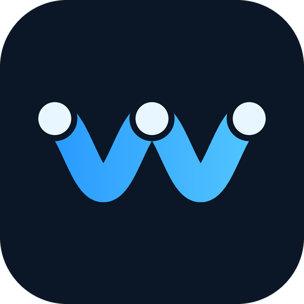

# Wave Command



Wave Command is a hands-free computer interaction project. It uses a webcam to recognize hand gestures and map them to computer actions, with a long-term goal of supporting control across applications and the operating system.

## First iteration

This iteration focuses on a small set of common actions, prioritizing web-browser use. Each action has its own hand pose, so the gestures do not trigger each other:

| Pose | Movement | Action |
|---|---|---|
| Pinch-ready claw: ring and pinky curled, index and middle relaxed and slightly bent | Move the hand | Move the cursor; pinch from this pose to click |
| Upright open palm facing the camera | Move up or down | Scroll (hand up scrolls down, hand down scrolls up) |
| Index and middle fingers extended, ring and pinky curled | Swipe sideways | Switch browser tab (Ctrl+Tab / Ctrl+Shift+Tab) |
| Index, middle, and ring fingers extended, pinky curled | Swipe sideways | Switch window (Alt+Tab / Alt+Shift+Tab) |
| Only the index finger extended | Swipe sideways | Browser back / forward (Alt+Left / Alt+Right) |
| Thumb tip to index tip | Pinch | Left-click |
| Thumb tip to index tip, twice within 1 s | Pinch, open, pinch | Double-click |
| Thumb tip to middle tip | Pinch | Right-click |

Swipe directions are measured in the (unmirrored) camera image: right-to-left means previous tab, previous window, or back, and left-to-right means next tab, next window, or forward.

- **Cursor:** see [Moving the cursor](#moving-the-cursor) below.
- **Pinches outside pointing** must be armed by showing an upright open palm first, and each pinch uses up the arming. The pinch threshold is `0.45` times the wrist-to-middle-MCP hand size, so clicks register before the fingertips touch. If both pinch ratios are within the threshold but differ by less than `0.08`, the pose is ambiguous and does not click.
- **Double-click:** after a left click, a 1-second window opens. A second left pinch within it sends a double-click, and it is easier to make: it counts from a pinch ratio of `0.55`, on its first frame, and needs no open palm. The first click selects and the double-click opens, as with a mouse. The window closes after the second pinch, so a third quick pinch is a normal click again.
- **Scrolling** starts after about `0.15` hand sizes of vertical movement. It disarms pinches: release the open palm and present it again before pinching.
- **Tab, window, and history** swipes must be brisk (within 0.8 s). Bringing the hand back is ignored, so the return stroke does not undo the action; swipe the same way again to repeat.
- **Window switching** sends a single Alt+Tab, so repeated "next" swipes alternate between the two most recently used windows, and "previous" (Alt+Shift+Tab) jumps to the least recently used one. Alt is held down briefly around the Tab press, because Windows ignores an instant Alt+Tab.
- **Cooldowns:** clicks 1.5 s (except the second pinch of a double-click); tab, window, and history navigation 1 s. After a tab or window switch, clicks and history are also paused for 1 s.

Actions are printed to the terminal and shown in the status overlay (and on the video HUD when the camera preview is open). Scrolling acts on the window under the cursor. See [docs/recognition-and-gestures.md](docs/recognition-and-gestures.md#cursor-control) for the full pointing walkthrough. The close-window gesture is temporarily disabled. These boundaries do not limit the broader project direction.

## Moving the cursor

1. **Make the hand shape.** Fold your **ring finger and pinky** down into your palm. Keep your **index and middle fingers** up but **slightly bent**, not straight (straight is the tab-switch "V"). Let the thumb rest loosely to the side, as if about to grab a small ball with three fingers. Keep your palm facing the camera; with MediaPipe, the engine uses landmark depth to see the fingers bending toward the camera.

   ```text
      index  middle
        \    /        <- slightly curved, not stiff
         \  /
     thumb  [ring + pinky folded down]
   ```

2. **Hold it still for a moment** (5 frames, about 0.2 seconds) facing the camera. The video window shows `CURSOR` with `hold still... 1/5 … 5/5`, then `pinch thumb + index/middle to click`.
3. **Move your whole hand**, keeping the shape. The cursor follows the centre of your palm, like sliding a mouse on a desk: hand right moves the cursor right, hand up moves it up. Slow movement gives small, precise steps; quick movement crosses the screen.
4. **Click** by touching your thumb to the index fingertip (left-click) or the middle fingertip (right-click) for a moment. No open palm is needed first. The cursor freezes just before the click (`frozen - finish the pinch to click`), so it clicks where you aimed. Open the fingers clearly before the next click; one pinch is one click. To **double-click**, open and pinch the index again within 1 second; the hint shows `pinch again to double-click` while you can.
5. **Reposition** like lifting a mouse: drop the hand out of view, bring it back somewhere comfortable, and point again. The cursor does not jump.
6. **Stop** by opening your hand. The cursor stays where it is, and the other gestures work again. Scrolling and swipes are off while pointing.

**Emergency stop:** move the physical mouse into any screen corner; PyAutoGUI's fail-safe stops the app.

**Pause gestures:** click the **pause** button in the status overlay (or press **B** in the camera preview) to turn gesture actions off without quitting; click **play** to turn them back on. See [Run](#run).

**More than one hand in view:** only the first hand that appeared is used; other hands are ignored (drawn as a thin grey skeleton in the camera preview). Another hand takes over only after the first one has been out of view for a few frames.

If the cursor does not move, press **D** for the detailed view and check the **Pointer** and **Flex 3D** lines: `off` means the shape is not recognized (compare the index and middle flex values with the claw band, and curl the ring and pinky further), `arming` that never completes means the hand is moving or the shape is unsteady, and `frozen for click` means the thumb is too close to a fingertip. See [Development and testing](docs/development-and-testing.md#the-cursor-does-not-move) for tuning.

## Requirements

- Python 3.10–3.12
- A webcam
- Windows, macOS, or Linux

MediaPipe provides the default 21-landmark hand detector, so the webcam flow works without downloading custom model weights. If a compatible 21-keypoint YOLO hand-pose model is available, install the optional dependencies with `python -m pip install -r requirements-yolo.txt` (this pulls in Ultralytics and PyTorch) and place the weights at `models/hand-pose.pt`; the detector will use it instead. Standard COCO pose models have 17 body keypoints and are not compatible.

## Setup

From the repository root, create and activate a virtual environment:

```powershell
py -3.12 -m venv .venv
.\.venv\Scripts\Activate.ps1
```

On macOS or Linux, use `python3 -m venv .venv` and `source .venv/bin/activate`.

Install dependencies and verify the model backend:

```powershell
python -m pip install --upgrade pip
python -m pip install -r requirements.txt
python scripts/setup_models.py
```

`setup_models.py` creates the `models/` directory, verifies MediaPipe Hands, and checks for optional local YOLO weights. It does not download unverified weights.

## Run

```powershell
python main.py
```

### Run without VS Code or a terminal (Windows)

Create Desktop and Start Menu shortcuts once, with the virtual environment active:

```powershell
python scripts/create_shortcut.py
```

Then start **Wave Command** from the Desktop or the Start Menu (it can be pinned to the taskbar from there). The shortcut runs `wave_command.pyw` with the virtual environment's `pythonw.exe`, so no console window opens. Terminal output goes to `wave-command.log` in the project folder, and a crash shows an error dialog pointing to it. Quit with the overlay's **✕**. Pass `--no-desktop` or `--no-start-menu` to skip a location, and run the script again if the project folder or virtual environment moves. On macOS or Linux, run `pythonw wave_command.pyw` (or `python wave_command.pyw`) instead.

The app has its own logo (`assets/`) in the shortcuts, the taskbar, and the camera preview window. Regenerate it with `python scripts/make_logo.py`.

### Using the app

Allow webcam access if prompted. A small, always-on-top **status overlay** opens centered at the top of the screen, styled in the Wave Command electric blue. It is a single row of icons:

- **Mode icon**, in the mode's color: check mark (`READY`), crossed-out eye (`NO HAND`), pointer arrow (`CURSOR`), mouse with **L**/**R** (`LEFT CLICK`/`RIGHT CLICK`), up/down chevrons (`SCROLL`), clock (`HISTORY`), stacked pages (`TABS`), task view (`WINDOWS`), or pause (`BYPASSED`, in the overlay's blue).
- **Last action** in a blue box: arrows for back/forward and scroll up/down, stacked pages with an arrow for next/previous tab, task view with an arrow for next/previous window, or a mouse with **L**/**R** for clicks (**2** for a double-click). Empty when there is no recent action.
- **Hand dot:** green while a hand is tracked, orange when none is in view. While bypassed it stays orange, even with a hand in view, because the hand drives nothing.

Drag it anywhere with the mouse. It never takes focus, so shortcuts still reach the browser. Its buttons:

- **pause** / **play**: turn gesture actions off and back on (both icons are in the overlay's blue). While bypassed, the hand is still tracked and the overlay shows the `BYPASSED` pause icon, but no cursor movement, clicks, scrolls, or shortcuts are sent. A gesture still held when you resume does not fire; release it and repeat it.
- **camera**: open or close the camera preview (dimmed while the preview is hidden).
- **✕**: quit Wave Command.

The overlay's icons come from Windows' Segoe Fluent Icons (Windows 11) or Segoe MDL2 Assets (Windows 10); on other systems plain Unicode symbols are used. Mode hints are shown only in the camera preview.

The camera preview is hidden at start. When open, it displays hand landmarks and a compact HUD: the current mode in large type with a one-line hint, FPS, and the last action as a short banner. With the preview focused, press **B** to toggle bypass, **C** to hide the preview, **D** to toggle the detailed tuning readout (raw gesture, pointer and pinch state, poses, finger-curl, 3D flexion, and pinch ratios), and **Q** to quit.

Set `SHOW_STATUS_OVERLAY = False` in `src/config.py` to run without the overlay (the preview is then always shown), or `SHOW_CAMERA_PREVIEW = True` to open the preview at start. If Tk is unavailable, the app falls back to the camera preview.

## Project layout

- `src/recognition/` — hand landmark detection and geometric gesture rules.
- `src/translation/` — gesture-to-action mapping and cursor control.
- `src/webcam/` — camera capture, visualization, and the always-on-top status overlay.
- `wave_command.pyw` — windowless launcher used by the shortcuts.
- `assets/` — the app logo (`logo.png`) and Windows icon (`wave_command.ico`).
- `scripts/setup_models.py` — backend and optional weights verification.
- `scripts/create_shortcut.py` — creates the Desktop and Start Menu shortcuts (Windows).
- `scripts/make_logo.py` — draws the logo and icon in the brand colors.
- `requirements.txt` / `requirements-yolo.txt` — base dependencies / optional YOLO backend.
- `tests/` — unit tests; no webcam or real input needed.
- `docs/` — full documentation, starting at [docs/README.md](docs/README.md).

Run the unit tests with:

```powershell
python -m unittest discover -s tests
```
